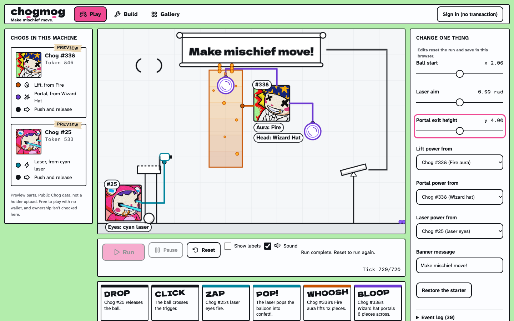
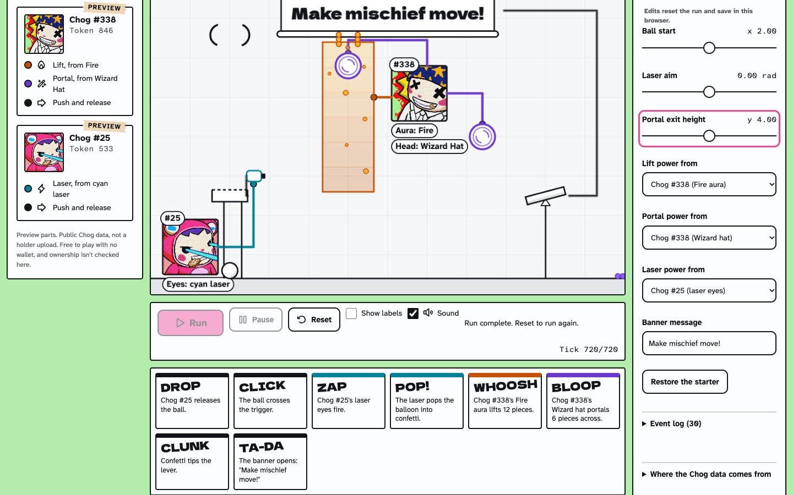
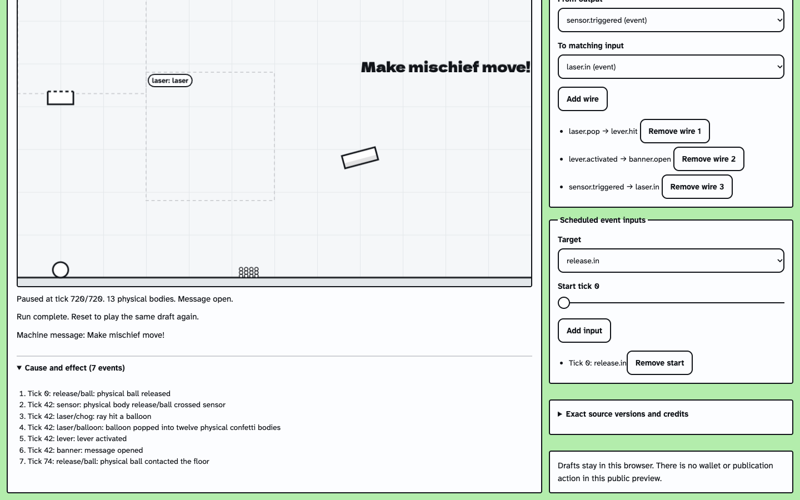
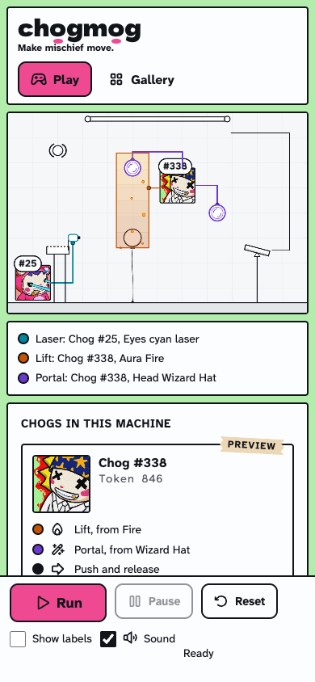

# chogmog

Make mischief move.

Chogmog is a browser game where Genesis Chogs power silly chain-reaction machines. Each Chog's traits decide what it can do. A Chog with a Fire aura can lift things, a Wizard Hat opens portals and laser eyes can pop balloons. Set up the parts, press Run and watch the chain play out.

**Play it now at [chogmog.vercel.app](https://chogmog.vercel.app).** It's free, and you don't need a wallet or an NFT.



## How to play

1. Open **Play**. Two Chogs are already set up in a machine.
2. Press **Run**. A ball drops, a laser fires, a balloon pops, confetti floats up through a portal, a lever tips and your banner opens.
3. Change one thing, like where the ball starts or which Chog powers the laser, and run it again to see what breaks or what new trick happens.
4. When the run ends, the comic strip under the stage shows each step that happened.



## The screens

- **Play** is the starter machine. Tweak it and run it as many times as you like.
- **Build** is where you make your own machine. Add parts, connect them with wires and run it. Your draft is saved in your browser.
- **Gallery** shows machines and parts other players have published. It's empty for now because nobody has published yet.
- **My Chog** lets you turn a Chog into a reusable part. Without a Chog of your own you can try it with a preview Chog, and you can use what you make in your Build draft.



It works on phones too.



## Chog powers

| Trait | Power |
| --- | --- |
| Any Chog | Push and release a ball |
| Fire aura | Lift things up |
| Wizard Hat or Wizard Beanie | Open a portal |
| Laser eyes | Fire a laser |
| Some mouths | Shout and blow nearby things away |

## Holders and previews

If you own a Genesis Chog, you'll be able to sign in with your wallet and publish parts made from it. Signing in only asks you to sign a message. It doesn't cost gas, move your NFT or ask for any approval. Your name stays on the parts you publish, even if you sell the Chog later.

Anything marked **PREVIEW** uses public Chog data, not someone's own Chog. Preview parts stay in your browser and can't be published.

Holder publishing hasn't been tried by a real Genesis holder yet.

## Credits

- Genesis Chog artwork and traits come from the public Genesis collection on Monad.
- Sounds are from [Kenney](https://kenney.nl), released under CC0.
- Icons are from [Phosphor Icons](https://phosphoricons.com), under the MIT licence.
- Fonts are Dela Gothic One and Atkinson Hyperlegible, under the SIL Open Font License.

The Chogmog code is released under the [MIT licence](LICENSE). That covers the code only. The Chog artwork, sounds, icons and fonts keep their own terms listed above.

Found a security problem? Please report it privately, as described in [SECURITY.md](SECURITY.md).

## For developers

You need Node 24 and pnpm. Nothing else is needed to run the game locally, so no wallet, database or keys.

```sh
pnpm install --frozen-lockfile
pnpm dev
```

Then open http://localhost:5173. Run `pnpm check` before opening a pull request. It runs the type check, lint, tests and build.

Publishing needs a Postgres database and some server settings. See `.env.example` for the settings and run `pnpm db:migrate` to set up the database. Without them the game still works and publishing is just switched off.

The project plan lives in Notion: [project hub](https://app.notion.com/p/3f3c5381831281e9b8d8e4f7fdb8e322), [Build](https://app.notion.com/p/3f3c5381831281718d4ada67960ba5a4), [Tasks](https://app.notion.com/p/3f3c5381831281f8b8bbc290b0de3e03) and [Handoff](https://app.notion.com/p/3f3c538183128181bc4fc6c482e4b04c).
